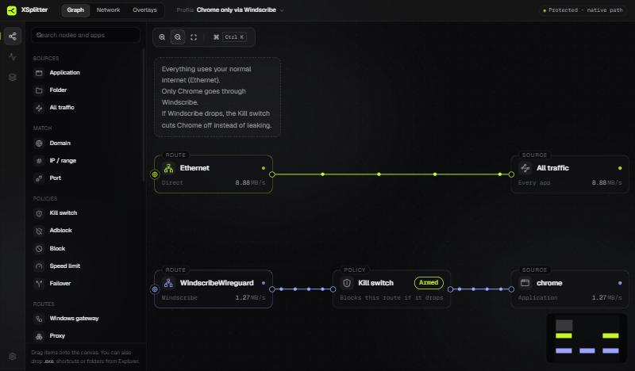

  

<h1 align="center">XSplitter</h1>

  <b>Per-app network routing for Windows, wired up like a node graph.</b> 
  Send each app, domain or IP through the VPN, proxy or network you choose. Everything else keeps your normal internet.

  <a href="https://raw.githubusercontent.com/danialk1382/X_Splitter-releases/main/XSplitter_0.1.13_x64-setup.exe"><b>⬇ Download XSplitter 0.1.13</b></a>
  &nbsp;·&nbsp; Windows 10 / 11 (64-bit) &nbsp;·&nbsp; 6.0 MB &nbsp;·&nbsp; released 2026-11-14

  

---

## What's new in 0.1.13

IP extractor switch on Domain and Exclude nodes (matches by address without changing Windows DNS). DNS: no longer left on 127.0.0.1 after a restart, only taken while a route that needs it is connected, and lookups no longer wait for a server that does not answer. A site behind a shared CDN address stays in Exclude. Hover a node for 2 seconds to see what it does. Network tab marks Windows system processes and VPN apps; system processes can only be speed-limited, and a VPN app is never sent into its own tunnel. Faster service start.

## What it does

XSplitter replaces "everything through the VPN" with rules you draw. Each rule is a path from a
**source** (an app, a folder of apps, a domain, an IP range or all traffic), through optional
**policies**, to a **route** (a network card, a VPN, a proxy or a tunnel).

| | |
|---|---|
| **Split tunneling per app** | Chrome through Windscribe, games through Ethernet, Telegram through a proxy: each app goes where you point it. |
| **Domains and IPs** | Route or block `*.discord.com`, `91.108.0.0/16` and so on, for every app or for one app only. |
| **Exclude** | Let some destinations skip a route, for example local `.ir` sites stay direct while Chrome uses the VPN. |
| **Kill switch** | If the protected route drops, its traffic is blocked instead of leaking to your normal internet. Scope it to a whole route or just a few domains. |
| **Multi-internet** | Several routes in priority order with automatic failover: when one goes down, new connections move to the next within seconds. |
| **Block, Adblock, Speed limit** | Block an app or destination, filter ads with DNS block lists, cap an app's upload and download. |
| **Proxies and tunnels** | SOCKS5 / HTTP proxies, WireGuard configs and V2Ray-style links (vless, vmess, trojan, shadowsocks, hysteria2, tuic) as routes. |
| **Network view** | Every app using the network with live speed, its connections, IPs and domains. Add any of them to the graph in one click. |
| **Overlays** | Small always-on-top widgets for speed, route status, ping and usage, with a hotkey to show or hide them. |
| **Profiles** | Separate graphs for home, work or gaming; export, import, switch by hotkey, Wi-Fi name or running app. |
| **Proxifier import** | Settings → Import .ppx turns a Proxifier profile into a graph, including disabled rules (switched off). |

Rules run in the Windows network stack through a background service, so they keep working while
the window is closed or in the tray.

## Install

1. Download **[XSplitter_0.1.13_x64-setup.exe](https://raw.githubusercontent.com/danialk1382/X_Splitter-releases/main/XSplitter_0.1.13_x64-setup.exe)**.
2. Run it and accept the Windows permission prompt. XSplitter installs a small background service
   that applies your rules, so administrator rights are needed once.
3. Open XSplitter, drag an app from the left onto the canvas and connect it to a route.
   Press **Apply** (Ctrl+S).

> **Windows SmartScreen** may say it "protected your PC" because the installer is new and not yet
> widely downloaded. Click **More info → Run anyway**.

### Updates

XSplitter updates itself. It checks shortly after it starts and then every few hours. When a new
version is out, **Update** appears in the title bar (also in Settings → Updates); one click
installs it and restarts the app. Your graphs and settings are kept, and every update is signed and
verified before it installs.

## Quick start

| I want to… | Draw this |
|---|---|
| Only Chrome through the VPN | `Chrome → VPN` |
| Chrome through the VPN, but never leak if it drops | `Chrome → Kill switch → VPN` |
| Chrome through the VPN, except local sites | `Chrome → Exclude (*.ir) → VPN` |
| Discord through a proxy, for every app | `Domain (discord.com, discord.gg) → Proxy` |
| Games always on Ethernet, the rest on Wi-Fi | `Games folder → Ethernet` and `All traffic → Wi-Fi` |
| Two internets with automatic failover | `All traffic → Multi-internet → Ethernet, Phone tether` |

Right-click the canvas for **Auto-arrange**, **Undo** and **Redo**; right-click a node to add a
description or a border color. Every node has an on/off switch in its top-right corner.

## Works with

Any VPN or proxy that shows up in Windows as a network adapter or a local proxy port, for example
Windscribe, WireGuard, OpenVPN, Proton VPN, Mullvad, NordVPN, Cloudflare WARP, v2rayN, NekoRay,
Hiddify and Clash. XSplitter detects the client and shows its logo on the route.

## FAQ

**Does it slow my internet down?**
Traffic that isn't routed by a rule is never touched. Apps routed to a network card or VPN adapter
go straight out of it; XSplitter doesn't add a proxy hop of its own. Proxy and V2Ray routes run
through a local tunnel, so they cost what the proxy itself costs.

**Is my traffic sent anywhere?**
No. XSplitter has no servers and no accounts. It only goes online to check for updates (this page),
to download the block lists you chose for Adblock, and to fetch sing-box from its official GitHub
release (checksum-verified) the first time you use a proxy or V2Ray route.

**Something stopped working. How do I undo everything?**
Settings → Recovery → **Restore network** removes every rule XSplitter added. Uninstalling also
removes them.

**Uninstall**
Windows Settings → Apps → XSplitter → Uninstall.

## Third-party software

XSplitter ships [WinDivert](https://reqrypt.org/windivert.html) (LGPLv3) and
[wireguard-nt](https://git.zx2c4.com/wireguard-nt/) (WireGuard LLC license) as separate components,
and downloads [sing-box](https://github.com/SagerNet/sing-box) (GPLv3) unmodified on demand.

---

This repository only hosts XSplitter releases. Files here are replaced on every release.

